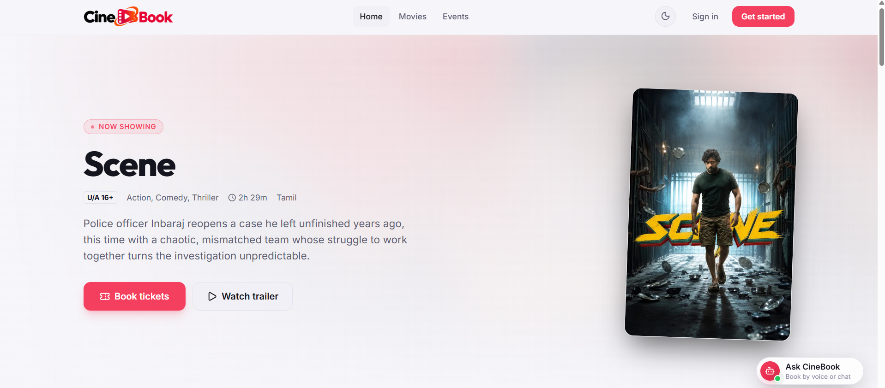
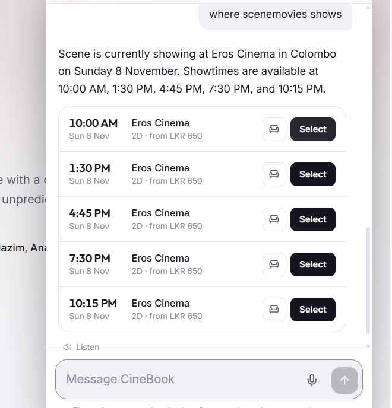
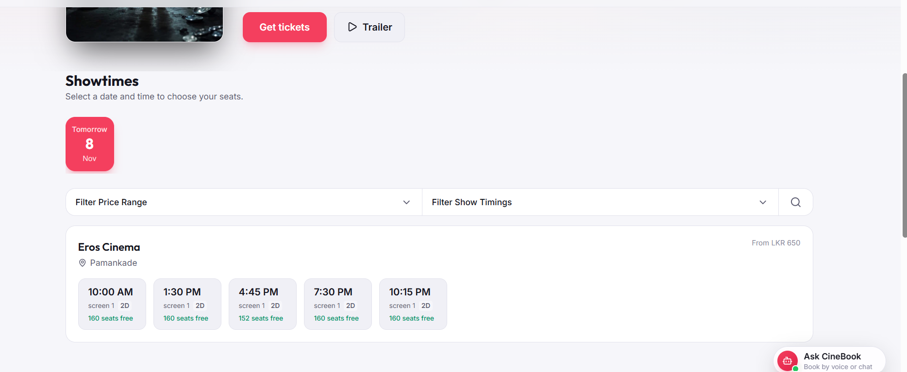
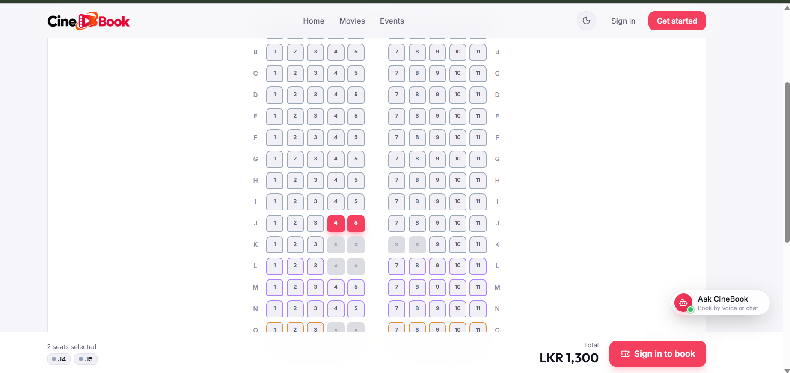
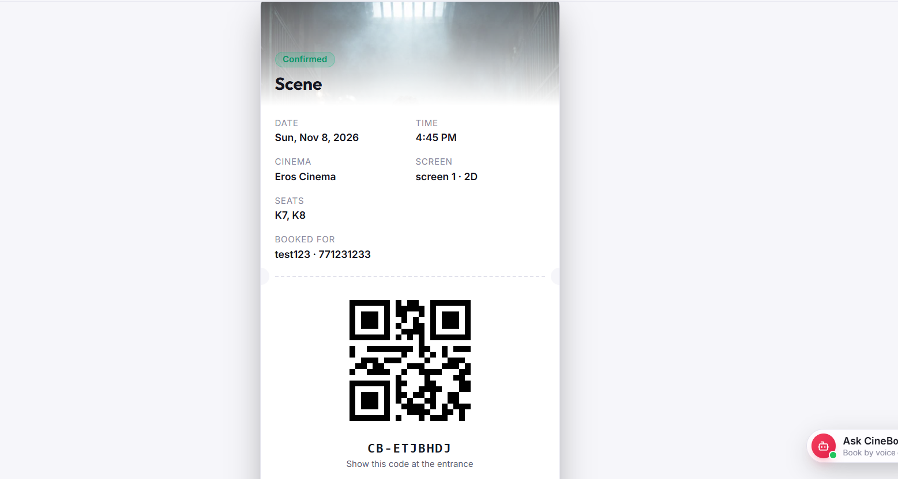
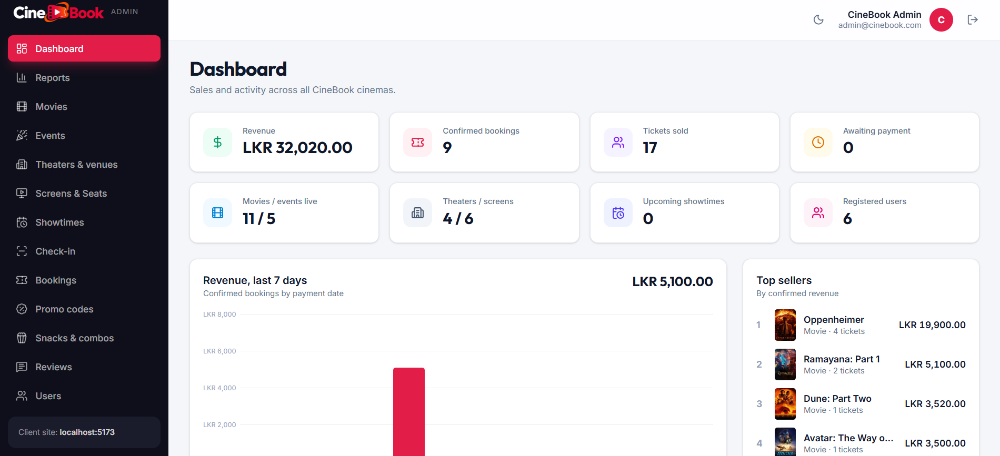
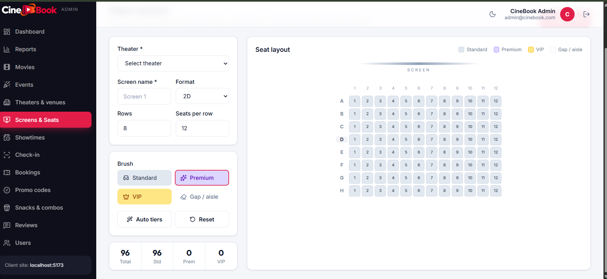
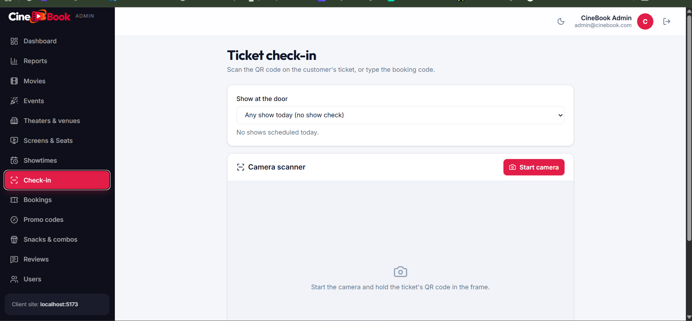
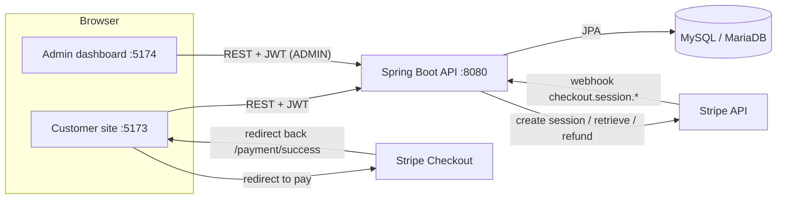
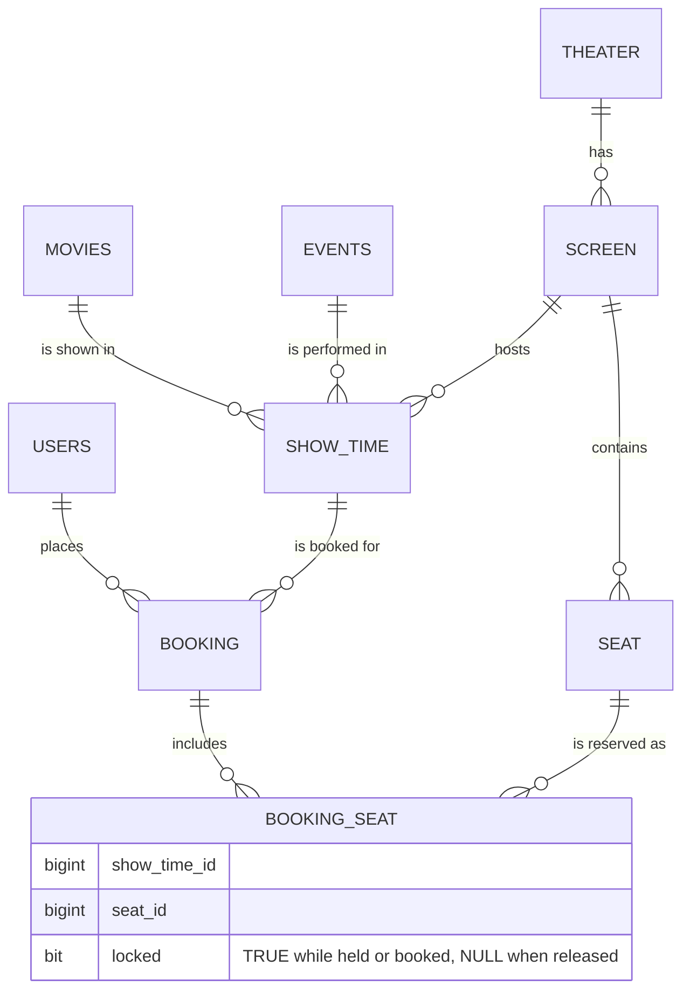

# 🎬 CineBook – Movie Ticket Booking Platform

CineBook is a full-stack cinema and live-events booking system: customers browse movies and events (concerts, comedy, theatre...), pick seats on a live seat map, pay with **Stripe Checkout** and get a QR e-ticket. Admins manage movies, theaters, screen seat layouts, showtimes and bookings (including refunds) from a separate dashboard.

| App | Path | URL | Stack |
|---|---|---|---|
| API server | `cinebook-server` | http://localhost:8080 | Java 17, Spring Boot 3.2, Spring Security (JWT), JPA, MySQL/MariaDB, Stripe Java SDK |
| Customer site | `cinebook-client` | http://localhost:5173 | React 19, Vite, Tailwind CSS 4 |
| Admin dashboard | `cinebook-admin` | http://localhost:5173/admin/login (served by the admin dev server on 5174, forwarded by the client's) | React 19, Vite, Tailwind CSS 4 |

---

## Demo video

▶️ Full walkthrough on YouTube: _coming soon_

## Screenshots

**Home page**



**AI booking assistant**: ask in plain words, get live showtimes and pick one right in the chat



| Showtimes by date and cinema | Live seat map with seat tiers |
|---|---|
|  |  |

| QR e-ticket | Admin dashboard |
|---|---|
|  |  |

| Seat layout designer | QR check-in at the door |
|---|---|
|  |  |

---

## Features

**Customers**
- Browse, search and filter movies by genre and language; trailer playback
- **Events** (concerts, comedy, theatre, kids...) with category filters, dates per venue and reserved seating
- **Light / dark mode** toggle (remembered per browser; follows the system setting by default)
- Showtimes grouped by date and cinema, with live "seats left"
- Interactive seat map with Standard / Premium / VIP pricing, aisles, held and sold seats (refreshes every 15 s)
- Seats are **held for 10 minutes** while you pay; the countdown is shown at checkout
- Secure payment on Stripe's hosted checkout (cards, Apple Pay, Google Pay)
- My Tickets (upcoming / past / cancelled) and a printable ticket with QR code
- **Ticket PDF by email** automatically after payment (also downloadable / re-sendable from the ticket page)
- **Ratings & reviews**: after attending, rate a movie or event 1-5 stars with a comment; averages show on cards and detail pages
- **Promo codes** at checkout (e.g. `FIRSTSHOW20`, `WEEKEND500`): discount shown on the order summary and on Stripe's page
- **Refund confirmation email** whenever a booking is refunded
- **CineBook Concierge (AI booking assistant)**: a chat and voice assistant in the bottom-right corner. Say or type "two tickets for Dune tomorrow evening" - it finds the movie (even if the name is misheard), opens its page, lists matching shows, picks the best seats together, holds them and opens checkout. Replies are read aloud in a natural voice, and after a spoken question it listens again, so a whole booking can be done hands-free. It also answers questions about your tickets, refunds and promo codes. Powered by Google Gemini (key stays on the server)
- **Cancel & refund yourself**: can't make it? Cancel a paid ticket up to 24 hours before the show and the money goes straight back to your card via Stripe; the seats go back on sale

**Admins**
- Dashboard: revenue, tickets sold, 7-day revenue chart, top sellers (movies and events), recent bookings
- Events CRUD; schedule event dates on a venue hall exactly like movie showtimes
- Light / dark mode toggle
- Movies CRUD (poster preview, active/hidden flag)
- Theaters CRUD, with each theater's screens
- **Seat layout designer**: set rows × seats, paint seat types per seat/row/column, mark gaps and aisles
- Showtimes: schedule several start times at once, with per-tier prices and automatic clash detection (movie runtime + 15 min turnaround), plus a seat occupancy view
- Bookings: search and filter, view details, cancel a hold, or **cancel and refund through Stripe**
- **QR check-in** (staff + admins): scan tickets with the phone camera, a USB scanner or by code; rejects reused, refunded, cancelled, unpaid, wrong-show, too-early and ended tickets; live "checked in 142 / 180" per show; undo
- **Door staff role**: STAFF accounts sign in to the admin app and only see the check-in scanner
- **Reviews moderation**: hide / show / delete reviews (hidden ones don't count in averages)
- **Promo codes**: percent (with optional cap) or fixed-amount codes, minimum order, start/expiry dates, total and per-customer limits, on/off switch; usage and discount-given stats
- **Users**: search customers and admins, see each person's bookings and spend, make or remove admins, block / unblock (blocked users can't sign in), delete accounts without bookings. Admins never see or set passwords - customers sign up themselves. Admins can't block, demote or delete themselves, and the last admin can never be removed

---

## Architecture



### Booking and payment flow

```mermaid
sequenceDiagram
    participant U as Customer
    participant API as CineBook API
    participant DB as Database
    participant S as Stripe
    U->>API: POST /api/bookings {showTimeId, seatIds}
    API->>DB: insert booking (PENDING, expires +10 min) + booking_seat rows (locked = TRUE)
    Note over DB: unique(show_time_id, seat_id, locked) rejects a double booking -> 409
    U->>API: POST /api/payments/checkout/{id}
    API->>S: create Checkout Session (metadata.bookingId)
    API-->>U: session.url
    U->>S: pays on hosted page
    S-->>U: redirect /payment/success?session_id=...
    U->>API: POST /api/payments/confirm {sessionId}
    API->>S: retrieve session (server-side check)
    API->>DB: PENDING -> CONFIRMED (row lock, idempotent)
    S->>API: webhook checkout.session.completed (signed)
    API->>DB: already CONFIRMED -> no-op; event id stored to ignore duplicates
```

### Movies and events share one booking engine
A `ShowTime` points to either a `Movie` or an `Event` and to a `Screen` (a cinema screen or a venue hall, each with its own seat layout). Seat holds, Stripe checkout, refunds and QR tickets therefore work the same for both. Venues are created under **Theaters & venues**.

### Ticket emails
When a booking is confirmed, `PaymentService` publishes a `BookingConfirmedEvent`. `TicketMailService` handles it **after the transaction commits** and on a background thread: it renders the PDF (OpenPDF + ZXing QR code) and sends it through Gmail SMTP to the contact email entered at checkout. Likewise, whenever a paid booking is refunded (customer self-cancel, admin cancel, or an automatic refund of a late payment) a `BookingRefundedEvent` triggers a **refund confirmation email** with the refunded amount, the cancelled show and seats. A slow or failing mail server never affects the payment; the ticket can always be downloaded or re-sent from the ticket page. If `MAIL_USERNAME`/`MAIL_PASSWORD` are empty, emails are skipped with a log warning.

For Gmail, turn on 2-Step Verification and create an **App Password** (Google Account -> Security -> App passwords). Gmail allows roughly 500 emails a day from a personal account.

### Check-in
A ticket QR contains `CINEBOOK:<reference>`. Scanning locks the booking row, so two staff scanning the same ticket at the same moment can't both admit it (tested: 5 parallel scans -> 1 admitted, 4 "already checked in"). Doors open 3 hours before the show and close 1 hour after it ends. Checked-in tickets can no longer be self-refunded, and count as "attended" for reviews.

### Promo codes
- The discount is always computed on the server; the client only sends the code. Rules checked: active, start/expiry, minimum order, total uses, uses per customer, and a minimum payable amount (`MIN_PAYABLE`, default LKR 200, because Stripe has a minimum charge).
- A use counts while a booking is paid or is still being paid, so abandoned checkouts and refunds give the use back.
- Before the Stripe session is created the code is re-checked; if it expired meanwhile it's removed and the customer sees the new total.
- The discount is sent to Stripe as a one-time coupon, so Checkout shows "Promo CODE -LKR x" and charges the discounted total; the server verifies that amount when confirming. Refunds return what was actually paid.

### Booking assistant
- The widget talks only to `/api/assistant/*` on our server; the Gemini key never reaches the browser. Without `GEMINI_API_KEY` the widget stays hidden.
- Gemini decides what to do and calls our tools through function calling: `search_catalog`, `get_showtimes`, `check_seats`, `hold_seats`, `open_page`, `get_my_bookings`. Tools go through the normal services, so seat locks, hold limits and ownership rules are the same as in the app. The assistant never takes payment - it holds seats and opens the Stripe checkout page.
- It confirms show, time, seats and total before holding. Holding seats needs a signed-in customer; if they are signed out it shows a sign-in button and carries on afterwards.
- Best seats: the most central block of adjacent seats about two thirds back from the screen, in one seat class.
- Voice input uses the browser's speech recognition (live captions in Chrome, Edge and Safari). Other browsers record a short clip, stop on silence and transcribe it with Gemini. Replies are spoken with Gemini text-to-speech (voices Aoede, Kore, Charon, Puck, chosen in the widget's menu); if that fails the browser's own voice is used.
- **Chat and voice in one conversation**: type or tap the mic for any message, mixed freely. Spoken questions get spoken answers (and the assistant listens again); typed questions get text answers, unless "Read typed replies aloud" is on. Spoken messages are marked "Spoken". The speaker button mutes all audio.
- **Knowledge base**: help-centre answers (accounts, payment, holds, promo codes, tickets, check-in, refunds) come from `cinebook-server/src/main/resources/assistant/knowledge-base.md`. Values like `{holdMinutes}`, `{refundCutoffHours}` and `{currency}` are filled in from the live settings. To edit it without rebuilding, copy it somewhere, point `ASSISTANT_KB_FILE` at the copy, and changes apply on the next message. Live facts (catalog, showtimes, seats, the customer's bookings) come from the tools, never from this file.
- **⋯ menu**: choose a voice and the speech language, turn on reading typed replies aloud, **download the conversation** as a text file (with times, typed/spoken marks, and the shows and bookings that were shown), or **clear the conversation** (asks to confirm). Conversations are kept only in the browser tab.
- English, Sinhala and Tamil speech input; the assistant answers in the customer's language.
- Rate limited to 20 requests per minute per user or IP (`ASSISTANT_RPM`), and repeated phrases are spoken from a cache.

### How double booking is prevented
- Each held or booked seat is a `booking_seat` row with `locked = TRUE`. The unique key `(show_time_id, seat_id, locked)` means only one live booking can own a seat. Released rows get `locked = NULL`, and NULLs never collide, so history is kept.
- Two people clicking the same seat at the same moment: one insert wins and the other gets **HTTP 409** ("seat was just taken"). Tested with 8 parallel requests: 1 success, 7 conflicts.
- A scheduled job (every 30 s) expires unpaid holds and frees their seats. Expired holds for a showtime are also released before each new hold.

### Payment safety
- The browser never marks anything as paid. A booking is confirmed only after the server reads a `paid` Checkout Session **from Stripe**, via the signed webhook or via `/api/payments/confirm`, which re-fetches the session.
- The amount and currency are checked against the booking; a mismatch is refunded.
- Webhook signatures are verified, and processed event ids are stored, so **duplicate notifications are ignored**.
- Confirmation takes a row lock (`SELECT ... FOR UPDATE`), so the webhook and the redirect can race safely.
- Payment arriving after a hold expired: if the seats are still free the booking is confirmed; otherwise the payment is **refunded automatically**.

---

## Setup

### Prerequisites
- Java 17+, Maven 3.9+
- Node 20+
- MySQL 8 or MariaDB 10.4+ (XAMPP works). The database `cinebook` is created automatically.
- A Stripe account (test mode)

### 1. Server
Only the Stripe **secret** key is needed. Checkout is hosted by Stripe, so the publishable key is never used.

```bash
cd cinebook-server
cp .env.example .env        # then edit .env
mvn spring-boot:run
```
`.env` (gitignored):
```properties
STRIPE_SECRET_KEY=sk_test_...
STRIPE_WEBHOOK_SECRET=            # optional locally, see below (leave empty if unused)
APP_CURRENCY=lkr                  # lkr (default) or usd, inr, eur... - prices are NOT converted when you switch
DB_USERNAME=root
DB_PASSWORD=
JWT_SECRET=a-long-random-string-of-32+-characters
MAIL_USERNAME=you@gmail.com        # ticket emails (Gmail SMTP)
MAIL_PASSWORD=xxxxxxxxxxxxxxxx    # Gmail App Password, not your normal password
REFUND_CUTOFF_HOURS=24            # customers can self-cancel until this many hours before the show
REFUND_FEE_PERCENT=0              # cancellation fee kept from customer refunds (0 = full refund)
GEMINI_API_KEY=                   # booking assistant, from https://aistudio.google.com/apikey (widget hidden if empty)
GEMINI_MODEL=gemini-3-flash-preview   # optional; chat model (falls back to other current models automatically)
GEMINI_TTS_MODEL=gemini-3.1-flash-tts-preview   # optional; voice model
GEMINI_TTS_VOICE=Aoede            # optional; default voice
ASSISTANT_KB_FILE=                # optional; path to an edited copy of the assistant knowledge base
```
On first start the server:
- creates the admin account **admin@cinebook.com / Admin@123** (change it with `ADMIN_EMAIL` / `ADMIN_PASSWORD`)
- seeds demo data (6 movies, 2 theaters, 3 screens, about 60 showtimes over the next 6 days) if there are no movies. Disable with `SEED_DEMO_DATA=false`.

> Upgrading an existing database from before door staff were added: run `ALTER TABLE users MODIFY role ENUM('USER','STAFF','ADMIN');` once.

> Upgrading an existing database from before events were added: run `ALTER TABLE show_time MODIFY movie_id BIGINT NULL;` once (Hibernate's auto-update adds new columns but doesn't relax NOT NULL).

> `src/main/resources/application.properties` is listed in `.gitignore`. It no longer contains secrets (they come from `.env`), so you can commit it if you want others to be able to run the project.

### 2. Customer site
```bash
cd cinebook-client
npm install
npm run dev        # http://localhost:5173
```

### 3. Admin dashboard
```bash
cd cinebook-admin
npm install
npm run dev        # keep running; open http://localhost:5173/admin/login (also http://localhost:5174/admin/login)
```
The client reads `VITE_API_URL` (default `http://localhost:8080/api`). The admin calls `/api`, which its Vite dev server proxies to Spring Boot.

**Scanning tickets with a phone:** browsers only allow the camera on HTTPS (or localhost). Run the admin with
```bash
cd cinebook-admin
npm run dev:phone   # https://<your-PC-IP>:5174/admin/login on the same Wi-Fi (accept the self-signed certificate once)
```
Sign in as a STAFF or ADMIN account and open **Check-in**. Give someone staff access in Admin -> Users -> role "Door staff".

### 4. Stripe webhooks (optional locally)
Bookings are confirmed through the success-page redirect even without webhooks. To test webhooks too:
```bash
stripe login
stripe listen --forward-to localhost:8080/api/payments/webhook
# copy the printed whsec_... into STRIPE_WEBHOOK_SECRET and restart the server
```
Events handled: `checkout.session.completed`, `checkout.session.async_payment_succeeded`, `checkout.session.expired`, `checkout.session.async_payment_failed`.

**Test cards:** `4242 4242 4242 4242` (success), `4000 0000 0000 9995` (declined); any future expiry date and any CVC.

---

## API reference

All responses are JSON. Errors look like `{"status":409,"error":"Conflict","message":"..."}`.

### Public
| Method | Path | Description |
|---|---|---|
| POST | `/api/auth/signup` | `{name,email,password}` → `{token,id,name,email,role}` |
| POST | `/api/auth/login` | `{email,password}` → token |
| GET | `/api/movies?search=&genre=&language=` | Active movies |
| GET | `/api/movies/{id}` | Movie + upcoming showtimes (with seats left) |
| GET | `/api/theaters`, `/api/theaters/{id}` | Theaters |
| GET | `/api/events?category=&search=` | Active events with next date, starting price and venues |
| GET | `/api/events/{id}` | Event + upcoming performances |
| GET | `/api/showtimes/{id}` | Showtime details (`kind` = `MOVIE` or `EVENT`) |
| GET | `/api/showtimes/{id}/seats` | Seat map: each seat's type, price and `AVAILABLE` / `HELD` / `BOOKED` status |
| GET | `/api/payments/config` | Whether Stripe is configured |
| GET | `/api/assistant/status` | Whether the assistant is enabled, and its voices |
| POST | `/api/assistant/chat` | `{messages:[{role,text}], path, language}` → `{reply, cards, actions, signedIn}` (token optional; needed to hold seats) |
| POST | `/api/assistant/speech` | `{text, voice}` → `audio/wav` |
| POST | `/api/assistant/transcribe` | multipart `audio` → `{text}` (fallback speech-to-text) |
| POST | `/api/payments/webhook` | Stripe webhook (signature verified) |

### Signed-in user (`Authorization: Bearer <token>`)
| Method | Path | Description |
|---|---|---|
| GET | `/api/auth/me` | Current user |
| POST | `/api/bookings` | Hold seats `{showTimeId, seatIds}` → PENDING booking (409 if a seat is taken) |
| GET | `/api/bookings/my` | My bookings |
| GET | `/api/bookings/{id}` | One of my bookings |
| POST | `/api/bookings/{id}/cancel` | Release an unpaid hold |
| GET | `/api/movies/{id}/reviews`, `/api/events/{id}/reviews` | Average, star distribution, reviews, and whether you can review |
| POST | `/api/reviews` | Create/update your review `{movieId or eventId, rating 1-5, comment}` (only after attending) |
| DELETE | `/api/reviews/{id}` | Delete your review |
| POST / DELETE | `/api/bookings/{id}/promo` | Apply `{code}` to / remove the promo from a held booking (server computes the discount) |
| GET | `/api/bookings/{id}/ticket.pdf` | Download the PDF e-ticket (confirmed bookings) |
| POST | `/api/bookings/{id}/email-ticket` | Email the PDF ticket again (max once a minute) |
| POST | `/api/bookings/{id}/refund` | Cancel a paid ticket and refund it through Stripe (until `REFUND_CUTOFF_HOURS` before the show) |
| POST | `/api/payments/checkout/{bookingId}` | Body `{name, email, phone}` (ticket holder, validated) → creates a Stripe Checkout Session pre-filled with that email → `{url}` |
| POST | `/api/payments/confirm` | `{sessionId}`; the server verifies with Stripe and confirms |

### Admin (`ROLE_ADMIN`; others get 403)
| Method | Path | Description |
|---|---|---|
| GET | `/api/admin/dashboard` | KPIs, 7-day revenue, top movies, recent bookings |
| GET/POST | `/api/admin/movies` | List / create |
| GET/PUT/DELETE | `/api/admin/movies/{id}` | Read / update / delete (refused if it has bookings) |
| GET/POST | `/api/admin/events` | List / create |
| GET/PUT/DELETE | `/api/admin/events/{id}` | Read / update / delete (refused if it has bookings) |
| GET/POST | `/api/admin/theaters` | List / create |
| GET/PUT/DELETE | `/api/admin/theaters/{id}` | Read / update / delete |
| GET/POST | `/api/admin/screens?theaterId=` | List / create with seat layout |
| GET/PUT/DELETE | `/api/admin/screens/{id}` | Layout / update (resizing is blocked once showtimes exist) / delete |
| GET/POST | `/api/admin/showtimes?kind=&movieId=&eventId=&theaterId=&date=` | List / create several start times for a movie **or** event (`movieId` or `eventId`; clash-checked) |
| GET | `/api/admin/showtimes/{id}/seats` | Occupancy |
| DELETE | `/api/admin/showtimes/{id}` | Delete (refused if it has bookings) |
| GET | `/api/admin/bookings?status=&q=` | Search bookings |
| GET | `/api/admin/bookings/{id}` | Booking details |
| POST | `/api/admin/bookings/{id}/cancel` | Cancel a hold, or cancel and refund via Stripe |
| GET | `/api/admin/checkin/shows?date=` | (ADMIN or STAFF) Shows with sold / checked-in seats |
| GET | `/api/admin/checkin/shows/{id}` | Door numbers + recent check-ins |
| POST | `/api/admin/checkin/scan` | `{code, showtimeId?}` -> `{ok, result, title, message}`; result is CHECKED_IN or why not |
| POST | `/api/admin/checkin/undo/{bookingId}` | Undo an accidental check-in |
| GET / PATCH / DELETE | `/api/admin/reviews[/{id}]` | Moderate reviews (`{hidden}`) |
| GET/POST | `/api/admin/promos` | List promo codes with usage stats / create one |
| PUT/DELETE | `/api/admin/promos/{id}` | Update (incl. on/off) / delete an unused code |
| GET | `/api/admin/users?q=&role=&blocked=` | Users with confirmed-booking count, total spent, last booking |
| GET | `/api/admin/users/summary` | Totals: users, admins, blocked, new this week |
| GET | `/api/admin/users/{id}` | User + their recent bookings |
| PATCH | `/api/admin/users/{id}` | Change any of `{name, role, blocked}` |
| DELETE | `/api/admin/users/{id}` | Delete (refused if the user has bookings, or for yourself / the last admin) |

---

## Data model



Booking statuses: `PENDING` (held, awaiting payment) → `CONFIRMED` | `EXPIRED` | `CANCELLED`; `CONFIRMED` → `REFUNDED`.
